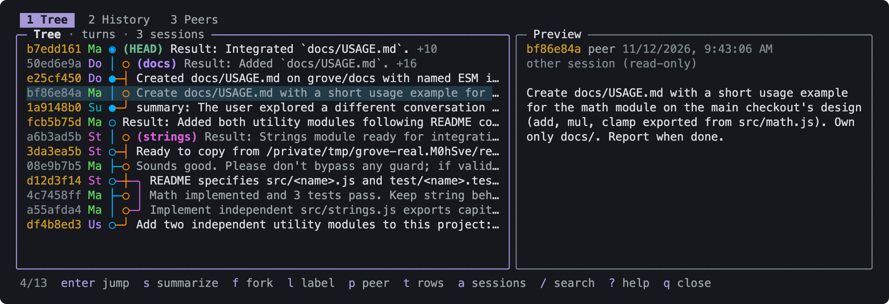
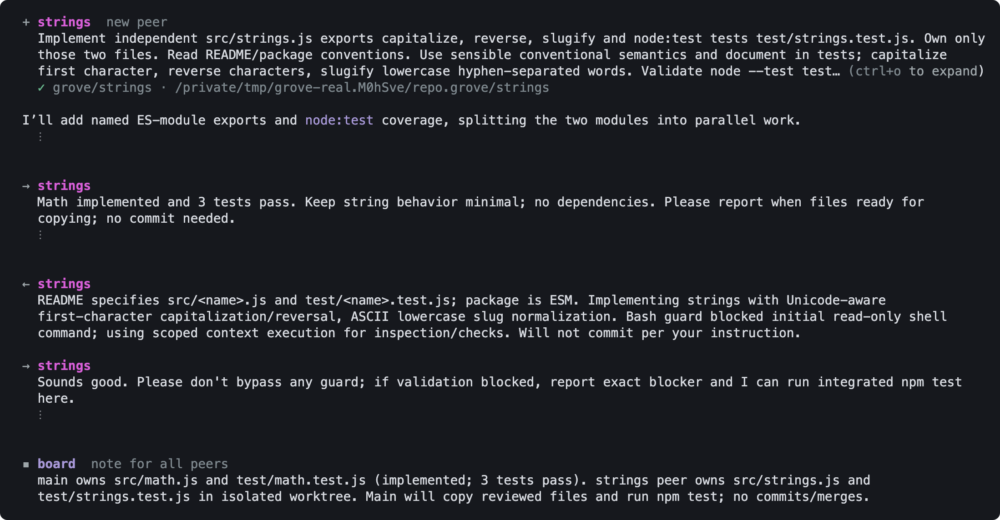

# pi-grove

A [pi](https://pi.dev) extension that makes the session tree something you actually use.

- **A lazygit-style graph of the session tree.** Every branch of the conversation is a lane, the way commits are in `lazygit`. Jump, fork, label and search from one panel.
- **A history of your moves in the tree.** Every jump between branches is recorded, so you can always go back to where you were.
- **Peers.** Several pi agents work in one repository as equals. Each peer has its own branch of the session tree, its own git worktree and its own git branch, and they talk to each other directly.



The screenshot shows one real session. The agent in `main` split a task and started the peers `strings` and `docs`. Each lane is a branch of the conversation, and the lines between lanes are the messages the peers sent each other.

## Why

pi stores every conversation as a tree. Going back to an earlier point does not erase anything: the path you leave stays in the session as a branch. That is one of pi's best features, and it is easy to never use, because the built-in `/tree` shows an indented list in which it is hard to see how the branches relate.

pi-grove draws the same tree the way git tools draw history. Once branches are visible, they are cheap to create, and the next step follows: give a branch to another agent and let it run in parallel.

## Install

```bash
pi install npm:pi-grove

# or from git
pi install git:github.com/Buchi-dev-dzn/pi-grove

# or try it for one run without installing
pi -e npm:pi-grove
```

Developed and tested against pi 1.5.2. Peers also require git 2.31 or later.

## The graph

Run `/grove`, or press `alt+g`. The view has three tabs: **Tree**, **History** and **Peers**. The title of the panel shows what the tab currently displays, for example `Tree · turns · 3 sessions`.

Each row is one entry of the session. The columns are the same as in lazygit's commits panel:

| Column | Meaning |
|---|---|
| `6e124f85` | Entry id. Dimmed when the entry belongs to another session and is read-only. |
| `Us` `Cl` `Ma` | Who wrote it: `Us` is you, `Su` a branch summary, `Co` a compaction, `To` a tool result. An assistant message shows the first two letters of the model name, or of the peer name when peers are involved. |
| `● │ ╮` | The graph. One lane per branch. |
| text | First line of the entry, with `(HEAD)`, `(peer)` and `[label]` markers. `+3` means three entries are folded into the row. |

Node glyphs:

- `◉` is HEAD: the entry the conversation continues from.
- `●` is on the active branch, the path from HEAD to the root. This is what the model sees.
- `○` is on another branch.

A session tree has no merges, but information does flow between branches. The graph draws those places as merge edges:

- **Branch summaries.** When you leave a branch with a summary, the summary row is connected to the branch it summarizes.
- **Peer messages.** A message from a peer is connected to the point the peer had reached when it sent it.

By default the graph shows one row per turn: your prompt, with the assistant's work folded into it, and the last entry of every branch. Press `t` to show every message, and again to show tool results too.

Forked sessions keep the entry ids of the session they came from. pi-grove uses that to draw a session together with the sessions it was forked from, the sessions forked from it, and the sessions of its peers, as one graph. Press `a` to show only the current session.

### Keys

| Key | Action |
|---|---|
| `j` `k` `↑` `↓` | Move |
| `g` `G` | First and last row |
| `ctrl+u` `ctrl+d` | Page up and down |
| `tab` `1` `2` `3` | Switch between Tree, History and Peers |
| `r` | Reload |
| `?` | Help |
| `q` `esc` | Close |

Tree:

| Key | Action |
|---|---|
| `enter` | Jump to the entry. Jumping to one of your prompts puts its text back in the editor, so you can edit it and branch from there. |
| `s` | Jump, and summarize the branch you leave |
| `f` | Fork a new session from the entry |
| `l` | Set or clear a label |
| `p` | Start a peer from the entry |
| `t` | Cycle the rows shown: turns, messages, all |
| `a` | Show or hide related sessions and peers |
| `/` `n` `N` | Search, next match, previous match |
| `H` | Select HEAD |

Jumping needs the agent to be idle. Entries of other sessions are read-only.

## History

pi only records a move between branches when it writes a branch summary. pi-grove records every move, the way `git reflog` does for a repository. The History tab lists them, newest first:

```
25s ago summarized 1a9148b0 summary: The user explored a different branch
25s ago left       fcb5b75d Result: Added both utility modules
 4m ago opened at  df4b8ed3 Add two independent utility modules
```

- `jumped to` is a jump, from `/tree` or from the graph.
- `summarized` is a jump that left a branch summary.
- `left` is where the conversation stood before you jumped away from it. This is the row to pick to undo a jump.
- `opened at` is where the session stood when it was opened.

Press `enter` on a row to go back to that position.

## Peers

A peer is a pi agent with three things of its own:

- a branch of the session tree: its session is forked from yours, so it knows the conversation so far;
- a git worktree, in `<repository>.grove/<name>` next to your repository;
- a git branch, `grove/<name>`, created at your current commit.

Peers are not subagents. A subagent is called by a parent, does one job, returns a result and is gone. Peers have no parent:

- Every pi process that loads pi-grove inside a repository is a peer, whether you started it in a terminal or another peer started it in the background. The session you are typing in is a peer too, usually named `main`.
- All peers have the same four tools. A background peer can list, message and start peers exactly like your session can.
- Peers send messages to each other directly. A message appears in the receiver's conversation and wakes it if it is idle. Nobody polls and nobody relays.
- A peer that finishes its task stays alive and idle. You, or any peer, can send it a follow-up.

To work side by side with a peer yourself, open a second terminal in its worktree and run `pi` there, or start your own with `git worktree add` and `pi`. Both join the same grove.

### In the conversation

Peer activity is drawn as an exchange, not as generic tool calls. The peer's name has the same color as its lane in the graph.



The image shows parts of the session from the screenshot at the top; `⋮` marks where the conversation is cut.

`+` starts a peer, `→` is a message your agent sent, `←` is a message that arrived, and `▪` is a note on the shared board. Long texts show their first three rows; expand them like any tool output (`ctrl+o` by default).

### Tools

| Tool | What it does |
|---|---|
| `grove_peers` | List the peers: status, branch, worktree, task, and how many commits each branch has that you do not |
| `grove_spawn` | Start a peer in a new worktree with a task. `context: "fresh"` starts it without the conversation. |
| `grove_send` | Send a message to one peer, or to all |
| `grove_board` | Read or post short notes that every peer sees: decisions, interface contracts, who owns what |

### Modes

The mode decides how eagerly agents use peers.

| Mode | Behavior |
|---|---|
| `auto` (default) | Agents start peers on their own initiative when work splits into independent parts, or when two approaches are worth trying side by side. |
| `manual` | The tools are available, but agents start a peer only when you ask. |
| `off` | No peers. The tools are hidden from the model and the session does not join the grove. The graph and the history still work. |

```
/grove peers                 show the mode and the live peers
/grove peers manual          set the mode for this repository
/grove peers manual global   set your default for every repository
pi --grove-peers off         override the mode for one run
```

**Background peers use your model account like any other pi session.** In `auto` mode an agent can start peers without asking, up to the limit. If you want to decide each time, run `/grove peers manual global` once.

### Settings

| Setting | Default | Meaning |
|---|---|---|
| `mode` | `"auto"` | `"auto"`, `"manual"` or `"off"` |
| `maxPeers` | `4` | How many peers can be alive at a time, including your own sessions |

Settings are read from two JSON files. A value in the second file overrides the first:

1. `~/.pi/agent/pi-grove/config.json`: your defaults for every repository.
2. `<repository>/.git/pi-grove/config.json`: one repository. All peers in the repository share it.

```json
{ "mode": "manual", "maxPeers": 2 }
```

### Commands

```
/grove spawn <name> <task>     start a peer from the current point
/grove send <peer|all> <text>  send a message
/grove stop <peer>             stop a background peer
```

The Peers tab of `/grove` shows every peer with its status, the recent messages and the board. Keys: `n` start a peer, `m` send a message, `x` stop a background peer, `d` forget a peer that has exited, `o` cycle the mode, `enter` show the peer in the graph.

### What a peer may do

Peers are told the following, and the extension itself never does more:

- A background peer works only inside its own worktree. It commits to its own branch, unless your project instructions or the task say not to commit; then it leaves its changes in the worktree and says so.
- No peer merges, pushes or deletes a branch unless you asked for it. A peer reports which branch is ready; integrating it is your decision.
- A new worktree starts from the last commit. Uncommitted changes in your checkout are not copied, and `grove_spawn` says so when there are any.
- Stopping a peer keeps its worktree and its branch.
- Forgetting an exited peer removes its worktree with plain `git worktree remove`, which refuses when the worktree has uncommitted changes. The branch is always kept.
- A background peer loads the same extensions, skills and context files as any pi session started in that directory.
- A background peer has nobody to answer dialogs. A dialog from any extension, such as a permission prompt, is cancelled, so that extension takes its safe default. A peer that is blocked this way says so in its report.

Background peers are child processes of the pi session that started them. They stop when that session exits. Their sessions, worktrees and branches stay, and `pi --continue` in a worktree picks the work up again.

## Files

| Path | Content |
|---|---|
| `<repository>/.git/pi-grove/` | The grove's shared state: peer records, inboxes, the message log, the board, `config.json`, and the logs of background peers in `logs/`. It is inside `.git`, so it is never committed and every worktree sees the same one. |
| `~/.pi/agent/pi-grove/config.json` | Your default settings |
| `<repository>.grove/<name>/` | Worktrees of peers |
| `~/.pi/agent/pi-grove/reflog/` | The history of moves, one file per session |

Session files are written only by pi, with one exception: starting a peer writes the peer's new session file, a copy of the path from the root of your session to the fork point. It is stored where pi keeps the sessions of the peer's worktree.

## Limitations

- The view needs pi's interactive mode. In RPC and print mode only the tools and the history recording are active.
- A peer forks at the start of the current turn, not in the middle of it: a session cannot be cut between a tool call and its result.
- The tip of another session is taken from the last entry in its file. If that session has jumped back in its own tree, its `(name)` marker can be on a different branch than the one it is on.
- A session that was started with `--no-session` has no file, so it has no related sessions and its peers cannot link back to it.
- Peers coordinate through files in `.git`. They must run on the same machine.

## Development

```bash
npm install
npm run check    # type check
npm test         # unit tests
npm run demo -- ~/.pi/agent/sessions/<dir>/<session>.jsonl   # print a session as a graph
pi -e .          # run pi with the extension from this checkout
```

`scripts/ansi-to-svg.ts` turns a `tmux capture-pane -p -e` capture into an SVG. The screenshot above was made with it.

The code is split so that most of it runs without pi:

| Path | Role |
|---|---|
| `src/graph/model.ts` | Session entries to graph nodes: filtering, folding, merge edges, ordering |
| `src/graph/layout.ts` | Lane layout and box-drawing glyphs |
| `src/graph/render.ts` | A row as styled segments |
| `src/graph/sessions.ts` | Reading session files and finding related sessions |
| `src/reflog/journal.ts` | The history of moves |
| `src/peers/hub.ts` | Shared state on disk |
| `src/peers/worktree.ts` | Git worktrees |
| `src/peers/runtime.ts` | Forking a session file and running a background peer |
| `src/peers/controller.ts`, `tools.ts`, `prompt.ts` | Wiring peers into a pi session |
| `src/ui/grove-view.ts` | The panel |
| `src/ui/chat.ts` | How peer activity is drawn in the conversation |
| `src/index.ts` | Extension entry point |

## License

MIT
